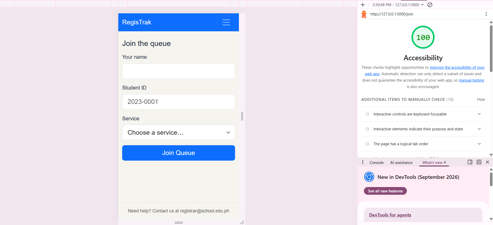
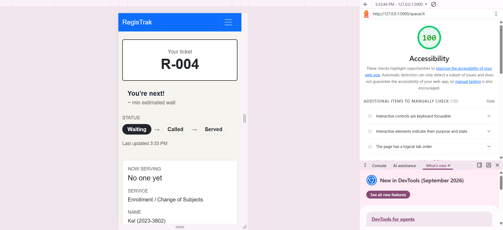
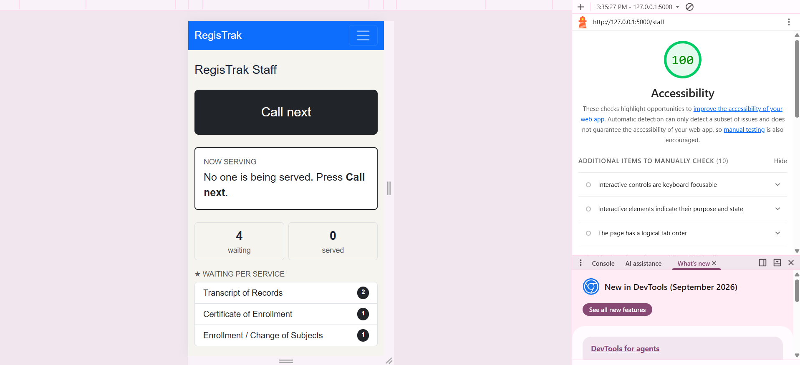

# Accessibility check

## 9a. Lighthouse

| Screen | Score | Screenshot |
| --- | --- | --- |
| Join | 100 |  |
| My place | 100 |  |
| Staff dashboard | 100 |  |

## 9b. Keyboard only

**Join the queue from the home page**
- I could see where the focus was at every step, except on the menu bar links ("Join the queue" and "Staff"), where the focus was hard to see against the blue background. Yes, I could reach and use every control, including the service dropdown and the Join Queue button. Yes, the skip link appeared on the first Tab, at the top left of the page.

**Staff dashboard**
- I could filter by service with the keyboard, use Call next, and use Mark served and No-show. Yes, I could see the focus at every step, except again on the menu bar links. Yes, the skip link also appeared on this screen.

## 9c. Manual checklist

| Check | Join | My place | Staff |
| --- | --- | --- | --- |
| Every input has a visible label | ✅ | N/A | ✅ |
| Error messages say what to do, in text | ✅ | N/A | N/A |
| Status is shown in words, not only color | N/A | ✅ | ✅ |
| Text and buttons are readable at 375 px with no sideways page scroll | ✅ | ✅ | ✅ |
| Buttons are at least about 44 × 44 px on a phone | ✅ | ✅ | ❌  |
| Page has one `<h1>` and headings in order | ✅ | ❌  | ✅ |
| `<html lang="en">` is set | ✅ | ✅ | ✅ |