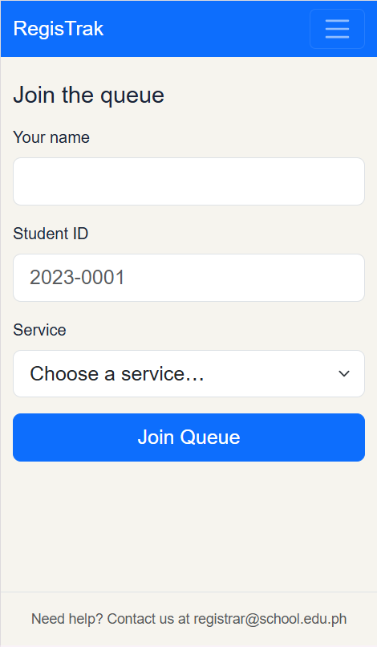
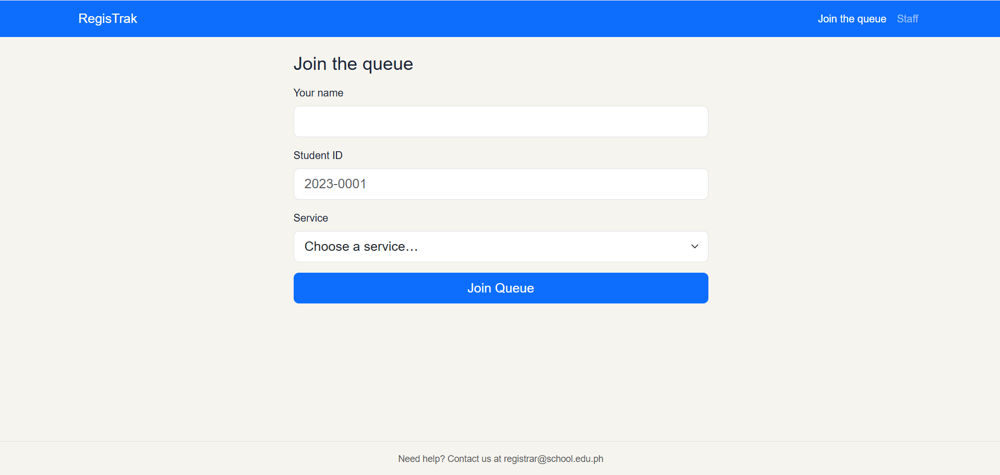
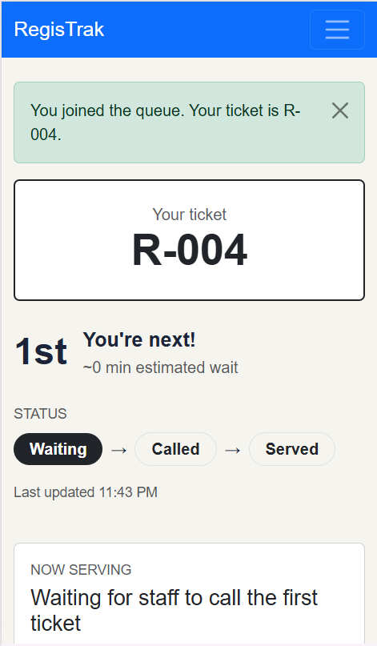
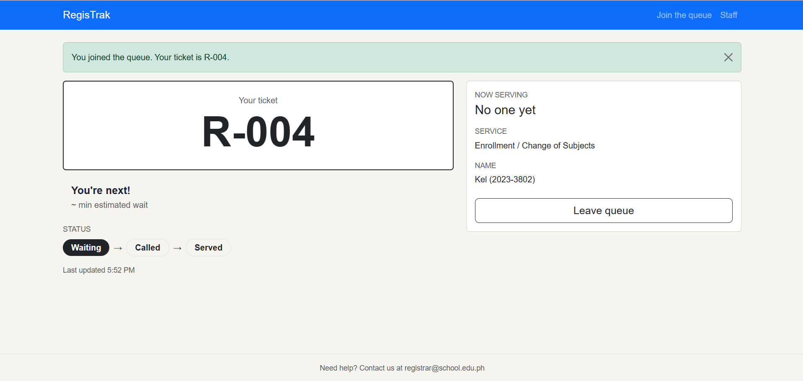
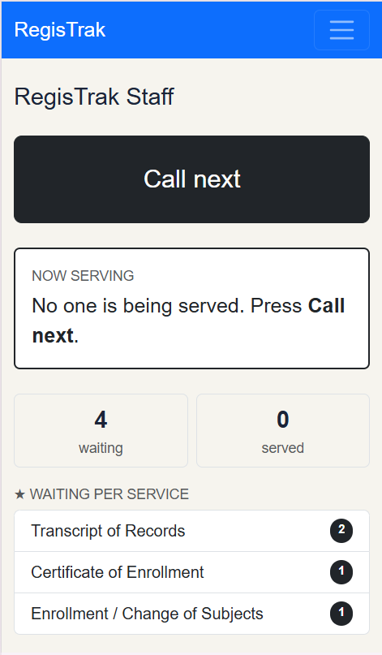
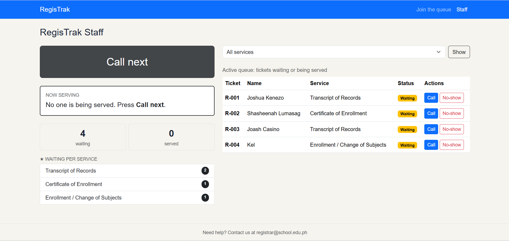
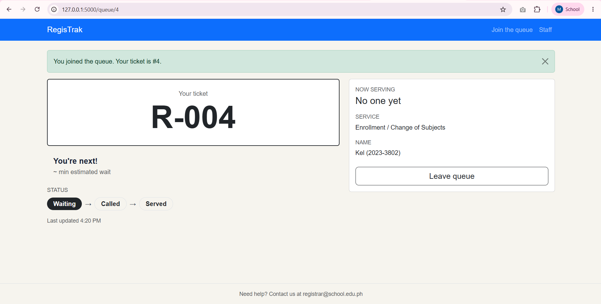

# RegisTrak: Week 3 Report

## 1. Title details

- **App name:** RegisTrak
- **Setting:** MSU-IIT Registrar's Office. A virtual queue where students join a line for registrar services and staff call and manage tickets.
- **Full name:** Michael S. Sumagui
- **Student ID:** 2023-3802
- **Section:** CS3B
- **Date:** October 25, 2026
- **Pull request:** ([#2](https://github.com/michaelsumagui-create/CCC181/pull/2))

## 2. Personas

Full details: [personas.md](personas.md)

**Gon, the student waiting** (22, 4th-year Computer Science student)
- Quote: "There's no need to line up. I can wait or pay in the cashier while virtually lining up in registrar..." (paste the full quote from personas.md)
- Top tasks: join a queue (FR-01), check queue number and status (FR-02), get a notification when the turn is near (FR-03).

**Killua, the registrar staff member** (MSU-IIT registrar office)
- Quote: "I need an organized queue so I can serve students efficiently without confusion."
- Top tasks: view the active queue (FR-04), call the next student (FR-05), mark a ticket as served (FR-06).

## 3. Screens

### Join the queue

Gon uses this on his phone to get a ticket without standing in line (FR-01).

Gon uses this on his laptop when he is in the library or dorm (FR-01).

### My place

Gon checks his ticket number, position and status here while waiting around campus (FR-02, FR-03).

Gon leaves this tab open on his laptop while studying (FR-02, FR-03).

### Staff dashboard

Killua uses this as a backup on a phone or tablet to call and serve tickets (FR-04, FR-05, FR-06).

Killua uses this on the office desktop at the counter to manage the whole queue (FR-04, FR-05, FR-06).

## 4. Design decisions

1. **The ticket number is the biggest thing on My place.** Gon needs to know his position at a glance (Gon rule 2), and he checks his phone while waiting nearby. My wireframe puts the number first, then "4th / 3 people ahead", then the status.
2. **"Call next" is the biggest button, at the top left of the dashboard.** Killua must call students in order (Killua rule 2) and does this all day, so it is the most frequent action and the easiest to reach.
3. **Skip / no-show asks for confirmation, and finished tickets turn grey but stay in the list.** My self-review found that "Mark served" and "Skip / no-show" sit close together, so a wrong tap was possible. Killua also needs to track completed requests (Killua rule 3).

## 5. Self-review

| Screen | Problem found | What I changed |
| --- | --- | --- |
| Join | No error prevention for a blank or wrong Student ID or for joining twice. Labels were small. | Added server-side error messages, a Student ID format check, a redirect to the existing ticket if the student is already in the queue, and large text (`form-control-lg`). |
| My place | "Last updated: just now" could be false if signal is lost. The wireframe only showed the WAITING state. | Added a real "Last updated" time, "No connection - retrying...", and a CALLED state with a green banner. |
| Staff dashboard | "Mark served" and "Skip / no-show" are close together. Served tickets were not shown. | Added a confirmation popup for no-show, and a grey "Completed requests" table. |

Not built yet: a "notifications are blocked" message and push notifications (FR-03). The page only shows a banner when the ticket is called.

## 6. Accessibility

| Screen | Score before | Score after |
| --- | --- | --- |
| Join | 100 | 100 |
| My place | 100 | 100 |
| Staff dashboard | 100 | 100 |

**Most important issue fixed:** No changes

Full results: [accessibility.md](accessibility.md)

## 7. Usability test

- **Task 1: Get in line for Enrollment / Change of Subjects: (47 seconds)** He did not hesitate, he just fill in his name and id number and what he needed to get in virtual line in registrar.
- **Task 2: How many people are ahead? What is your number? (33 seconds):** He did not hesitate, he noticed immediately the changes in their place (My place) and he saw immediately his ticket number and the persons ahead of him.
- **Task 3: As staff, call the next person and mark them as served (94 seconds):** He did not hesitate, he can immediately see the students virtually in line and also he can immediately calls them and mark as served and no show.

**The one improvement:** I make the green message says "Your ticket is R-004 instead of "#4"" for consistency and to prevent any confusions.

| Before | After |
| --- | --- |
|  |  |

Full notes: [usability-test.md](usability-test.md)

## 8. Reflection

**Hardest part this week:** Keeping the My place page updated without a reload, or understanding how the two `/join` routes work together).

**What I will change in Week 4 when the data moves to a database:**
- Tickets will not disappear when I restart the server, so I can test with real saved data.
- "Already in the queue" will become a database check on the Student ID.

## 9. Declaration

While working on this week's task, I made use of Claude. I used it to organize the steps, check my work, clarify any parts I didn't understand, and correct any mistakes.