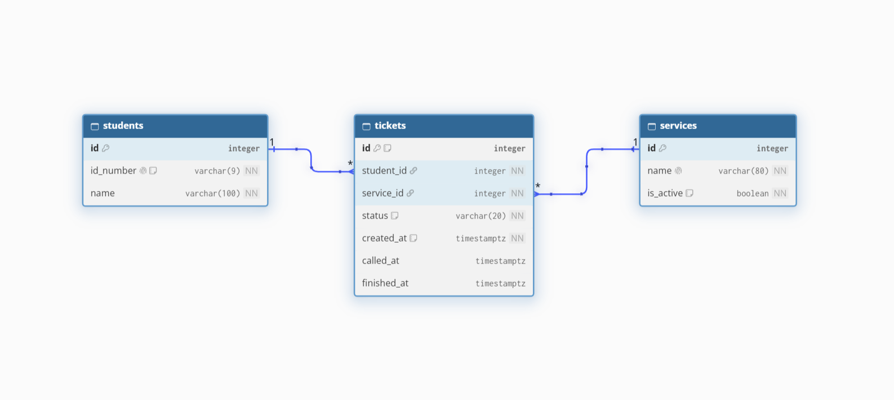
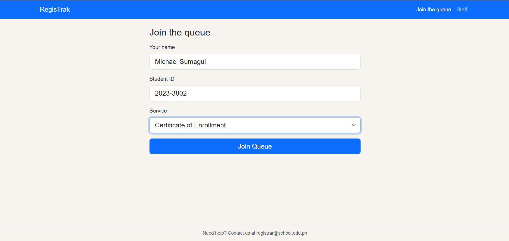
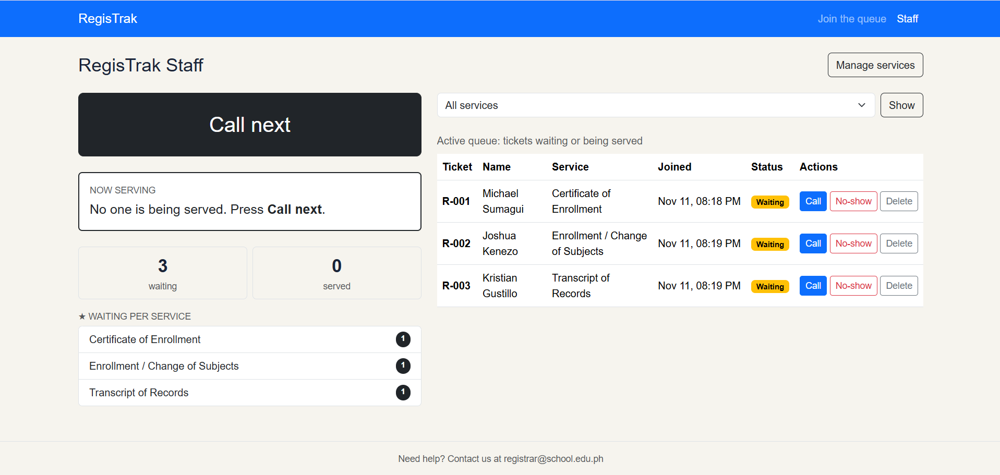
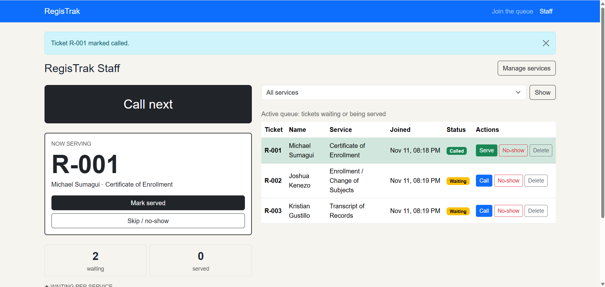
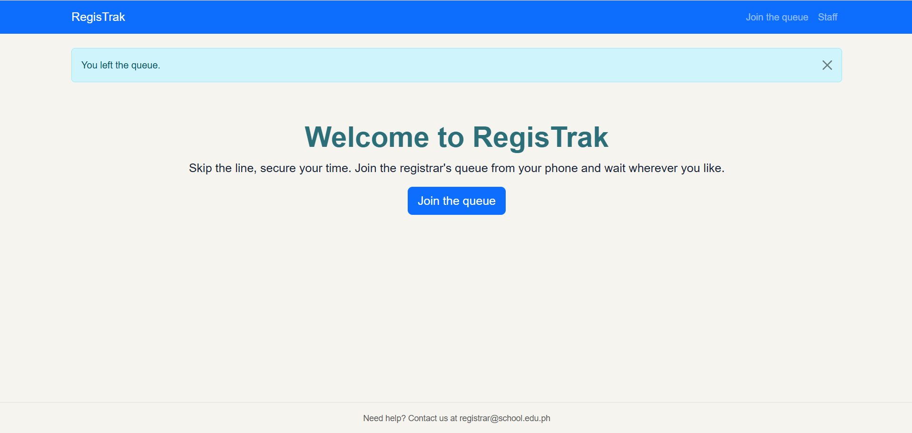
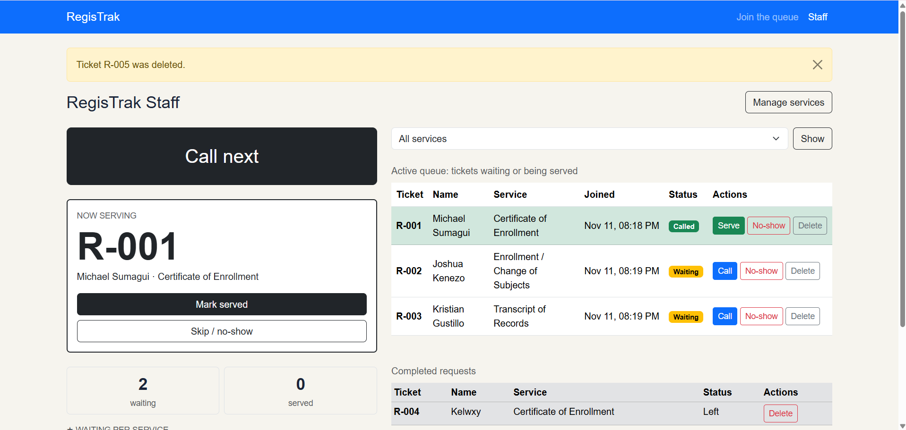
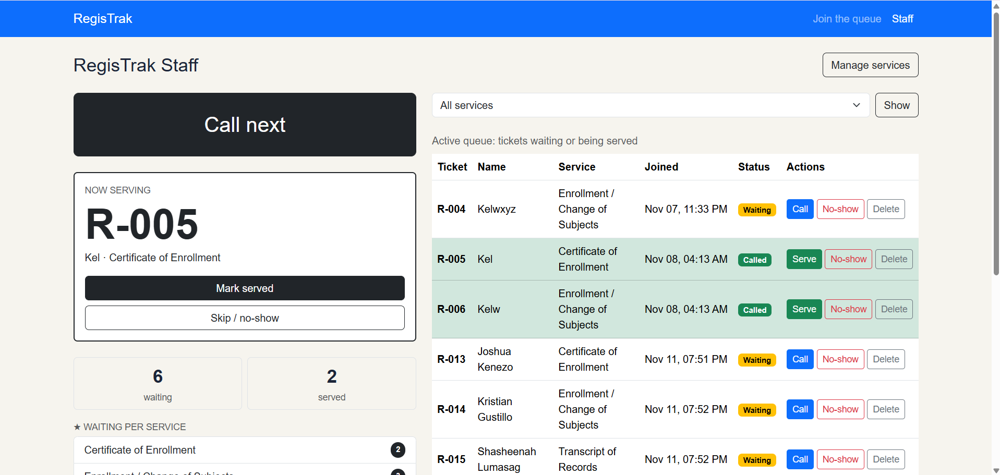

# RegisTrak: Week 4 Report

## 1. Title details

- **App name:** RegisTrak
- **Setting:** MSU-IIT Registrar's Office. A virtual queue where students join a line for registrar services and staff call and manage tickets.
- **Full name:** Michael S. Sumagui
- **Student ID:** 2023-3802
- **Section:** CS3B
- **Date:** November 11, 2026
- **Pull request:** [#3](https://github.com/michaelsumagui-create/CCC181/pull/3)
- **Database:** PostgreSQL 17 in Docker Compose

## 2. Requirements

Full list: [docs/requirements.md](../requirements.md)

- **Functional requirements:** 14 written (13 active, FR-14 dropped).
- **Non-functional requirements:** 6 written (NFR-01 to NFR-06).
- **MVP:** FR-01, FR-02, FR-04, FR-05, FR-06, FR-07, FR-09, FR-11, NFR-01, NFR-02, NFR-04 and NFR-05. This is the smallest version that still solves the problem: a student can join, see their place and leave, and staff can call and finish tickets, with every ticket saved in the database.
- **Person from my setting:** A student who experience adding and withdrawing a subject.
  - **What they said:** "Not necessary na mag butang ug estimation time kay naay mga circumstances na dili accurate kay basin naay unexpected na happenings sa sulod so dili na sya necessary, what necessary is kanang kabalo sya pangkapila sya sa line instead of time estimation"
  - **What I changed:** I dropped the FR-14 from "Later" to Dropped and I kept its ID so I don't use it again.

## 3. ERD



- One student has many tickets (1 : N). Each ticket belongs to exactly one student.
- One service has many tickets (1 : N). Each ticket belongs to exactly one service.
- Students and services are connected many-to-many through `tickets`.

Full design: [schema.md](schema.md)

## 4. Schema

`\d`

```
List of relations
 Schema |      Name       |   Type   |   Owner   
--------+-----------------+----------+-----------
 public | alembic_version | table    | registrak
 public | services        | table    | registrak
 public | services_id_seq | sequence | registrak
 public | students        | table    | registrak
 public | students_id_seq | sequence | registrak
 public | tickets         | table    | registrak
 public | tickets_id_seq  | sequence | registrak
(7 rows)
```

`\d students`

```
Table "public.students"
  Column   |          Type          | Collation | Nullable |               Default                
-----------+------------------------+-----------+----------+--------------------------------------
 id        | integer                |           | not null | nextval('students_id_seq'::regclass)
 id_number | character varying(9)   |           | not null | 
 name      | character varying(100) |           | not null | 
Indexes:
    "students_pkey" PRIMARY KEY, btree (id)
    "students_id_number_key" UNIQUE CONSTRAINT, btree (id_number)
Check constraints:
    "ck_students_id_number" CHECK (id_number::text ~ '^[0-9]{4}-[0-9]{4}$'::text)
Referenced by:
    TABLE "tickets" CONSTRAINT "tickets_student_id_fkey" FOREIGN KEY (student_id) REFERENCES students(id) ON DELETE RESTRICT
```

`\d services`

```
Table "public.services"
 Column |         Type          | Collation | Nullable |               Default                
--------+-----------------------+-----------+----------+--------------------------------------
 id     | integer               |           | not null | nextval('services_id_seq'::regclass)
 name   | character varying(80) |           | not null | 
 active | boolean               |           | not null | true
Indexes:
    "services_pkey" PRIMARY KEY, btree (id)
    "services_name_key" UNIQUE CONSTRAINT, btree (name)
Referenced by:
    TABLE "tickets" CONSTRAINT "tickets_service_id_fkey" FOREIGN KEY (service_id) REFERENCES services(id) ON DELETE RESTRICT
```

`\d tickets`

```
Table "public.tickets"
   Column    |           Type           | Collation | Nullable |               Default               
-------------+--------------------------+-----------+----------+-------------------------------------
 id          | integer                  |           | not null | nextval('tickets_id_seq'::regclass)
 status      | character varying(20)    |           | not null | 'waiting'::character varying
 created_at  | timestamp with time zone |           | not null | now()
 called_at   | timestamp with time zone |           |          | 
 finished_at | timestamp with time zone |           |          | 
 student_id  | integer                  |           | not null | 
 service_id  | integer                  |           | not null | 
Indexes:
    "tickets_pkey" PRIMARY KEY, btree (id)
    "uq_tickets_one_active_per_student" UNIQUE, btree (student_id) WHERE status::text = ANY (ARRAY['waiting'::character varying, 'called'::character varying]::text[])
Check constraints:
    "ck_tickets_status" CHECK (status::text = ANY (ARRAY['waiting'::character varying, 'called'::character varying, 'served'::character varying, 'no-show'::character varying, 'left'::character varying]::text[]))
Foreign-key constraints:
    "tickets_service_id_fkey" FOREIGN KEY (service_id) REFERENCES services(id) ON DELETE RESTRICT
    "tickets_student_id_fkey" FOREIGN KEY (student_id) REFERENCES students(id) ON DELETE RESTRICT
```

## 5. Design decisions

1. **Students are in their own table, and a ticket only stores a `student_id`.** In Week 3 the name was copied into every ticket. Now the Student ID identifies a person once, so a returning student like Gon gets a new ticket without a second copy of his name (FR-01, FR-09).
2. **The database enforces "one active ticket per student" with a partial unique index.** My self-review found that only my Python code stopped a double join. Gon taps buttons while walking to class, so a double tap must never create two tickets (FR-09, Gon rule 1).
3. **Leaving the queue sets the status `left`, not `no-show`, and the row stays.** Staff such as Killua need to tell people who left from people who did not come when called, and they need to track completed requests (FR-07, FR-06, Killua rule 3).

## 6. Self-review

Full review: [schema-review.md](schema-review.md)

| Problem found | What I changed |
| --- | --- |
| The rule "one waiting or called ticket per student" was only checked in Python. | Added a partial unique index, so the database enforces it. |
| Leaving and not showing up were both `no-show`. | Added a fifth status, `left`, to the CHECK constraint. |
| A student's name was typed on every visit. | The Student ID identifies the student, and the latest name typed wins. |
| Ticket numbers never reset every day. | Kept as it is, because resetting needs extra columns that the minimum version does not need. |

## 7. Migration:
1. **68de657b0e4d_initial_tables.py** -> Creates the `students`, `services` and `tickets` tables with their primary keys, unique and check constraints, foreign keys (`ON DELETE RESTRICT`) and the partial unique index that allows one waiting or called ticket per student.

2. **b44a654b8684_add_services_active.py.py** -> Renames `services.is_active` to `services.active`, so switching a service off keeps working with the existing rows. The downgrade renames it back.

I tested `flask db downgrade` and then `flask db upgrade` on the second migration, and both worked.

## 8. CRUD

| Operation | Route | Requirement | Screenshot |
| --- | --- | --- | --- |
| Create a ticket | `POST /join` | FR-01, FR-09 |  |
| Read My place and the dashboard | `GET /queue/<id>` and `GET /staff` | FR-02, FR-04 |  |
| Update a status | `POST /staff/call-next` and `POST /staff/tickets/<id>/<action>` | FR-05, FR-06 |  |
| Soft delete (leave the queue) | `POST /queue/<id>/leave` | FR-07 |  |
| Hard delete a mistaken ticket | `POST /staff/tickets/<id>/delete` | FR-15 |  |

Services also have create, update, switch off and delete (FR-11) on `/staff/services`.

## 9. Validation

Full notes: [validation.md](validation.md)

- **Summary:** I tested each rule at three layers. The browser stops simple mistakes, such as a name longer than 100 characters. When I skipped the form with `curl`, Flask still rejected bad input with `400 BAD REQUEST` and saved nothing. When I skipped Flask and typed SQL in psql, PostgreSQL rejected bad data with its own constraints (FOREIGN KEY, CHECK, UNIQUE, NOT NULL, column length and ON DELETE RESTRICT). I also found no SQL built from f-strings, because all queries use SQLAlchemy.
- **Most useful PostgreSQL error:** `ERROR: duplicate key value violates unique constraint "uq_tickets_one_active_per_student"`. It showed that the database itself enforces FR-09, so a student cannot have two waiting or called tickets even if my Python check fails, for example when someone double-taps Join. This is the problem my schema self-review found, and the partial unique index fixed it.

## 10. Persistence

Full steps: [persistence.md](persistence.md)




- **Restart test:** Every ticket, status and time was the same after `docker compose down` and `up -d`
- **Rebuild from scratch:** The app opened from the migrations and the seed command alone
- **NFR-01 (no ticket lost on restart):** Passed

## 11. Reflection

**Hardest part this week:** The hardest part was migrations. My model said `active`, but my first migration had created `is_active`. When I ran `db migrate`, Alembic did not see a rename. It wrote a script that added a new column and dropped the old one, which would have switched every service back on and lost the data in that column. I fixed it by rewriting the migration as one `alter_column` rename. I also found that my model had an index that no migration had created, so my models and my database disagreed. I learned that I must always open and read an auto-generated migration before running it, and that the database has to match the models after every change.

**Requirement hardest to write in a testable way:** NFR-01, "no ticket is lost when the app restarts." At first it was too vague to check. I had to turn it into a test I could repeat: create tickets in different states, run `docker compose down` and `up`, and compare the same SQL query before and after. Only then could I say whether it passed or failed.

**A report my staff persona would want from this data:** How many people left the queue before being served, per service, per day. The registrar could use it to see which services have the longest waits, and when to open another counter. The data is already in the database. Leaving the queue is a soft delete, so `tickets` keeps those rows with `status = 'left'`, together with `created_at` and `service_id`.

## 12. Declaration

While working on this week's task, I made use of Claude. I used it to organize the steps, correct my words, clarify any parts I didn't understand, and correct any mistakes.