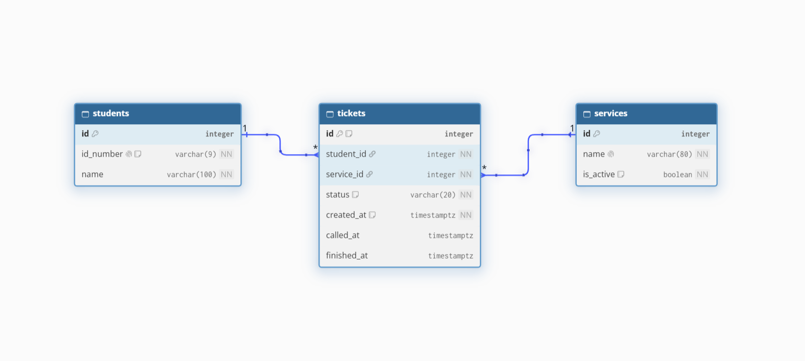

# RegisTrak schema design

## 2a. Nouns in my requirements

Only requirements with **Stores data? = Yes** are listed. Nouns are in **bold**.

| Req ID | Requirement | Nouns | Table or column? |
| --- | --- | --- | --- |
| FR-01 | A **student** can join the **queue** for a registrar **service** by entering their **name**, **Student ID** and service. | student, queue, service, name, Student ID | students, *(queue is not a table)*, services, students.name, students.id_number |
| FR-02 | A student can see their **ticket number**, **status** and how many people are **ahead** of them. | ticket number, status, ahead | tickets.id, tickets.status, *(ahead is computed)* |
| FR-03 | A student is **notified** when their turn is near or when they are called. | notification | *(Later: needs no table yet, it uses tickets.status and tickets.called_at)* |
| FR-04 | A staff member can see the active **queue** (waiting and called **tickets**) in order. | queue, tickets, order | *(queue is not a table)*, tickets, tickets.created_at |
| FR-05 | A staff member can call the next waiting **ticket**, for all services or for one service. | ticket, service, time called | tickets, services, tickets.called_at |
| FR-06 | A staff member can mark a called ticket as **served** or **no-show**. | status, time finished | tickets.status, tickets.finished_at |
| FR-07 | A student can **leave** the queue after joining. | status | tickets.status |
| FR-09 | The app accepts only a **Student ID** in the form 2023-0001, and a student already waiting gets their existing ticket instead of a second one. | Student ID, ticket | students.id_number, tickets |
| FR-11 | A staff member can add, **rename** and **switch off** a **service**. | service, name, active | services, services.name, services.is_active |
| FR-12 | A staff member can see **completed tickets** (served and no-show) in a separate list. | completed tickets, status | tickets.status |
| FR-13 | A graduating student can join a **priority lane** that is served first. | priority lane | *(Later: will add tickets.is_priority)* |

Two rules I followed:

- **The queue is not a table.** It is all tickets with status `waiting`, ordered by `created_at`.
- **Store facts, not results.** I store *when* a ticket was created. The position ("4th", "3 people ahead") is computed when the page loads.

## 2b. Tables and columns

| Table | Columns |
| --- | --- |
| `students` | id, id_number, name |
| `services` | id, name, is_active |
| `tickets` | id, student_id, service_id, status, created_at, called_at, finished_at |

Where each fact from Week 3 went, by asking: *is this about the person, the service, or this one visit?*

- **Student ID and name** are about the person, so they go in `students`.
- **Service name and whether it is open** are about the service, so they go in `services`.
- **Status and the times** are about one visit, so they go in `tickets`.

I did not add a `staff` table because staff login comes in a later week. I also did not add `is_priority` yet, because FR-13 is marked *Later*.

## 2c. Types and constraints

| Table | Column | PostgreSQL type | Constraint | Why |
| --- | --- | --- | --- | --- |
| students | id | integer, generated | PRIMARY KEY | Generated by the database, never reused |
| students | id_number | varchar(9) | NOT NULL UNIQUE, CHECK (id_number ~ '^[0-9]{4}-[0-9]{4}$') | One row per student, and only IDs like 2023-0001 |
| students | name | varchar(100) | NOT NULL | Staff need a name to call |
| services | id | integer, generated | PRIMARY KEY | Generated by the database, never reused |
| services | name | varchar(80) | NOT NULL UNIQUE | No two services with the same name |
| services | is_active | boolean | NOT NULL DEFAULT true | Staff can switch a service off without deleting it |
| tickets | id | integer, generated | PRIMARY KEY | This is the ticket number. The database gives each one a new number, so two students can never share one |
| tickets | student_id | integer | NOT NULL FOREIGN KEY REFERENCES students(id) | No ticket for a missing student |
| tickets | service_id | integer | NOT NULL FOREIGN KEY REFERENCES services(id) | No ticket for a missing service |
| tickets | status | varchar(20) | NOT NULL DEFAULT 'waiting', CHECK (status IN ('waiting', 'called', 'served', 'no-show')) | Only the four statuses my app uses |
| tickets | created_at | timestamptz | NOT NULL DEFAULT now() | Time zone safe, set by the database, decides who is first |
| tickets | called_at | timestamptz | NULL allowed | Empty until staff call the ticket |
| tickets | finished_at | timestamptz | NULL allowed | Empty until the ticket is served or marked no-show |

## 2d. ERD

**Relationships, read aloud:**

- One student has many tickets (1 : N). Each ticket belongs to exactly one student.
- One service has many tickets (1 : N). Each ticket belongs to exactly one service.
- Students and services are connected many-to-many **through** `tickets`: one student can visit many services, and one service serves many students.

The foreign key always sits on the "many" side, so `tickets.student_id` and `tickets.service_id` are the foreign keys.

**What happens when a parent row is deleted:**

| Foreign key | Rule | Reason |
| --- | --- | --- |
| tickets.student_id -> students.id | RESTRICT | A student with tickets cannot be deleted, because the registrar needs the history of completed requests (FR-12). |
| tickets.service_id -> services.id | RESTRICT | A service with tickets cannot be deleted, so old tickets keep their meaning. Staff switch a service off with `is_active` instead (FR-11). |

## 2e. Normalization check

1. **One value per cell (1NF):** No. Every column holds one value. There are no lists, and the status is one word.
2. **Depends on the whole key (2NF):** There is no join table with extra columns, because `tickets` is a normal table with its own single-column key. Every column in it depends on that ticket.
3. **No hidden copies (3NF):** No. A student's name is stored once in `students`, and a service's name is stored once in `services`. Tickets only hold the ids. In Week 3, the name was copied into every ticket, so changing a name meant changing many rows. This design removes that.